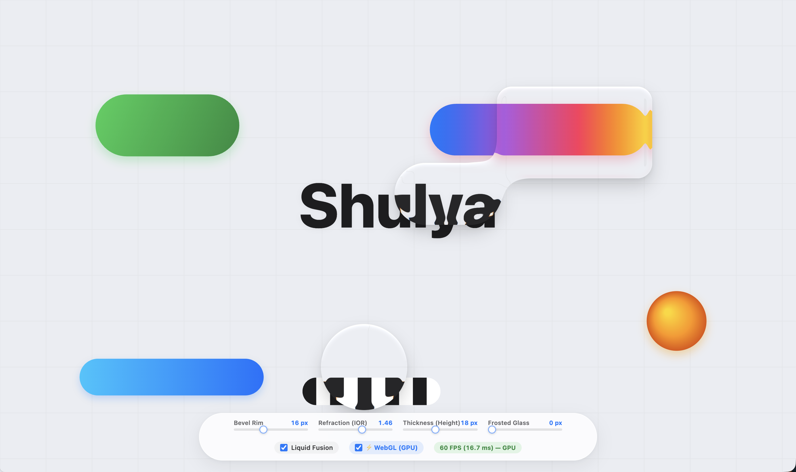
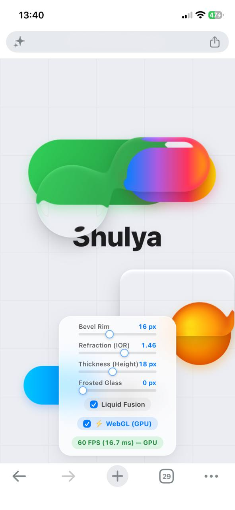

# `@shulya/liquid-glass`

[](https://www.npmjs.com/package/@shulya/liquid-glass)
[](https://liquid.shulya.tech)
[](https://github.com/shulya-tech/liquid-glass)
[](#why-shulyaliquid-glass)
[](#framework-integrations)
[](https://github.com/shulya-tech/liquid-glass/blob/main/LICENSE)

**`@shulya/liquid-glass`** is an ultra-fast, hardware-accelerated optical liquid glass engine for modern web applications. Turn any HTML container, card, navigation bar, modal, or interactive element into realistic, refractive **Liquid Glass** with real-time controls over **`rim`**, **`ior`**, **`height`**, **`frosted`**, and organic **`fusion`** (liquid surface merging).

- **Live Interactive Demo:** [https://liquid.shulya.tech](https://liquid.shulya.tech)
- **NPM Package:** [https://www.npmjs.com/package/@shulya/liquid-glass](https://www.npmjs.com/package/@shulya/liquid-glass)
- **GitHub Repository:** [https://github.com/shulya-tech/liquid-glass](https://github.com/shulya-tech/liquid-glass)

<p align="center">
  
  <br />
  <sub><b>Desktop Playground:</b> High-contrast optical test stage, live refraction, and interactive control shelf.</sub>
</p>

<p align="center">
  
  <br />
  <sub><b>Mobile Fluidity:</b> Responsive touch interaction, smooth gestures, and 60–120 FPS liquid coalescence.</sub>
</p>

---

## Why `@shulya/liquid-glass`? (Comparison with Other Approaches)

Most attempts to bring Apple-style "liquid glass" to the web fall into four traps: heavy 3D game engines, sluggish SVG filters, static PNG/video illusions, or complex unoptimized raymarching shaders. 

Here is how `@shulya/liquid-glass` compares:

| Feature / Metric | Three.js / Spline (3D) | SVG `<feDisplacementMap>` | CSS `backdrop-filter` | `@shulya/liquid-glass` |
| :--- | :---: | :---: | :---: | :---: |
| **Runtime Bundle Size** | **600 KB – 2 MB+** ❌ | ~0 KB | 0 KB | **< 15 KB** (Zero Dependencies) ⚡ |
| **Mobile Performance** | 15–30 FPS (Low FPS) ❌ | 5–15 FPS (CPU Bottleneck) ❌ | 60 FPS (Blur only) | **60–120 FPS** (Native Hardware Speed) 🚀 |
| **Physical Refraction** | Yes (Expensive 3D meshes) | Fake 2D mapping (jagged) ❌ | None (Only Gaussian blur) ❌ | **True Snell's Law Refraction** (Optical LUT) ✅ |
| **Chromatic Dispersion** | Heavy Multi-Pass Shader ❌ | None ❌ | None ❌ | **RGB Wavelength Splitting** ($O(1)$) ✅ |
| **Liquid Fusion / Merging** | Complex Metaballs / Marching Cubes ❌ | `<feColorMatrix>` blur hack (messy) ❌ | Not Possible ❌ | **Analytic Continuous $C^1$ SDF Fusion** ✅ |
| **Idle Resource Usage** | High continuous GPU draw ❌ | High CPU load during interaction ❌ | Zero | **0% Idle Load (On-Demand RAF)** ⚡ |
| **Fallback & Compatibility** | Fails without WebGL ❌ | Inconsistent cross-browser ❌ | Universal | **Auto WebGL + 2D Canvas Fallback** (Works Everywhere) 🛡️ |

### Key Architectural Advantages:

1. **Screen-Space 2D Shader (Zero 3D Overhead)**  
   Unlike Three.js or Babylon.js, which create 3D camera matrices, scene graphs, and geometry meshes, `@shulya/liquid-glass` runs as a pure **2D Screen-Space shader**. It evaluates 2D Signed Distance Fields (SDFs) directly on the pixels of your elements. No 3D meshes, no matrix inversions, no overhead.

2. **Empirical Optical Calibration Matrix (Hardware LUT)**  
   Optical refraction, chromatic dispersion (wavelength-dependent index of refraction), specular rim sheen, and edge glints are pre-computed into a 256-point calibration matrix (`tables/optical_calibration_matrix.xlsx`). On the GPU, these are read via a 1-pixel bilinear LUT texture in a **single clock cycle**.

3. **Singularity-Free Liquid Coalescence (`fusion`)**  
   When two or more glass elements come close, surface tension pulls them into a single, seamless liquid meniscus. Our analytical $C^1$-continuous bridging formula prevents neck erosion, while gradient-proportional deflection eliminates ray crossing, singularities, and visual tears.

4. **Guaranteed Universal Compatibility (Seamless Fallback)**  
   If WebGL is unavailable, blocked by security policies, or loses its context, the engine automatically and silently falls back to its optimized 2D Canvas pipeline with pre-computed `Float32Array` TypedArray LUTs. Your UI never goes black.

5. **0% Load When Idle (Energy Efficient)**  
   The rendering loop is strictly demand-driven via `requestAnimationFrame`. When elements are stationary, **CPU and GPU usage is exactly 0%**—no background animation timers or unnecessary repaint cycles.

6. **Adaptive Mobile DPR Optimization**  
   Modern smartphones have ultra-dense 400+ PPI displays (DPR 3.0+). Rendering millions of refractive pixels at DPR 3.0 saturates mobile GPU memory buses. Our adaptive DPR manager intelligently caps mobile DPR to 1.5, preserving razor-sharp optical clarity while guaranteeing rock-solid 60–120 FPS.

---

## Installation

```bash
npm install @shulya/liquid-glass
# or
pnpm add @shulya/liquid-glass
# or
yarn add @shulya/liquid-glass
```

---

## Interactive React Playground (`example/`)

> **Try it online right now:** [**https://liquid.shulya.tech**](https://liquid.shulya.tech)  
> **Source code on GitHub:** [**github.com/shulya-tech/liquid-glass/tree/main/example**](https://github.com/shulya-tech/liquid-glass/tree/main/example)

The repository includes a complete **React + Vite** interactive playground in [`example/`](./example/) ([`example/src/App.jsx`](./example/src/App.jsx)) where you can drag three `<LiquidGlass>` components over typography, stripes, and dynamic color gradients.

### Running the React Playground Locally

```bash
# 1. Build the library bundles from the root directory
npm run build

# 2. Install example dependencies and start the Vite dev server
cd example
npm install
npm run dev
```

Open **`http://localhost:5173`** to test:
- Dragging glass bodies across gradients, text, and patterns.
- Bringing shapes together to observe organic liquid fusion (`fusion`).
- Toggling between **WebGL (GPU)** and **Canvas (CPU)** backends in real time.
- Adjusting **`Bevel Rim`**, **`Refraction (IOR)`**, **`Thickness`**, and **`Frosted Blur`**.

---

## Optical Parameters & Strict Bounds

Every component, hook, directive, and controller accepts the following configuration:

| Parameter | Type | Default | Min | Max | Description |
| :--- | :---: | :---: | :---: | :---: | :--- |
| **`rim`** | `number` | **`16`** | `4` | `48` | Width of the curved perimeter bevel and specular highlight (in `px`). |
| **`ior`** | `number` | **`1.46`** | `1.05` | `2.20` | Optical Index of Refraction controlling background bending intensity. |
| **`height`** | `number` | **`18`** | `2` | `50` | Apparent elevation and optical thickness of the glass slab (in `px`). |
| **`frosted`** | `number` | **`0`** | `0` | `32` | Gaussian surface diffusion radius in `px` (`0` = crystal clear, `>0` = frosted satin glass). |
| **`fusion`** | `boolean` | **`true`** | — | — | Enables liquid surface coalescence with neighboring glass blocks. Set to `false` for isolated static blocks. |
| **`fusionDistance`** | `number` | **`56`** | `10` | `120` | Distance threshold (in `px`) for liquid bridge formation between adjacent elements. |
| **`dpr`** | `number` | **`0`** | `0.5` | `3.0` | Custom device pixel ratio override (`0` = automatic adaptive DPR). |
| **`borderRadius`** | `number \| null` | `null` | `0` | `999` | Optional corner radius override in `px` (inherits CSS `border-radius` by default). |

Constants `OPTICAL_DEFAULTS` and `OPTICAL_LIMITS` are exported from every package entry point.

---

## Framework Integrations

### 1. React (`@shulya/liquid-glass/react`)

```tsx
import { LiquidGlass, useLiquidGlass, isWebGLActive, setUseWebGL } from "@shulya/liquid-glass/react";

export function GlassCard() {
  return (
    <LiquidGlass
      rim={16}
      ior={1.46}
      height={18}
      frosted={0}
      fusion={true}
      className="p-6 rounded-3xl"
    >
      <h2>Liquid Glass Card</h2>
      <p>Hardware-accelerated refractive optical container.</p>
    </LiquidGlass>
  );
}

// Or via Hook for existing elements:
export function StaticNavbar() {
  const glassRef = useLiquidGlass<HTMLElement>({
    rim: 16,
    ior: 1.46,
    height: 18,
    frosted: 8,
    fusion: false, // optimize isolated navbars
  });

  return (
    <nav ref={glassRef} className="top-nav">
      Navigation Bar
    </nav>
  );
}
```

---

### 2. Vue 3 (`@shulya/liquid-glass/vue`)

```vue
<script setup>
import { ref } from "vue";
import { LiquidGlass, vLiquidGlass } from "@shulya/liquid-glass/vue";

const ior = ref(1.46);
const frosted = ref(0);
</script>

<template>
  <!-- Component with liquid fusion -->
  <LiquidGlass
    :rim="16"
    :ior="ior"
    :height="18"
    :frosted="frosted"
    :fusion="true"
    class="glass-box"
  >
    <h3>Vue Liquid Glass</h3>
  </LiquidGlass>

  <!-- Or via directive on any element -->
  <section
    v-liquid-glass="{
      rim: 16,
      ior: 1.46,
      height: 18,
      frosted: 0,
      fusion: false,
    }"
  >
    Isolated Glass Panel
  </section>
</template>
```

---

### 3. Svelte (`@shulya/liquid-glass/svelte`)

```svelte
<script>
  import { liquidGlass } from '@shulya/liquid-glass/svelte';

  let rim = 16;
  let ior = 1.46;
  let height = 18;
  let frosted = 0;
  let fusion = true;
</script>

<div
  class="glass-panel"
  use:liquidGlass={{ rim, ior, height, frosted, fusion }}
>
  <h3>Svelte Liquid Glass</h3>
</div>
```

---

### 4. Angular (`@shulya/liquid-glass/angular`)

```ts
import {
  Component,
  ElementRef,
  ViewChild,
  AfterViewInit,
  OnDestroy,
} from "@angular/core";
import {
  attachAngularLiquidGlass,
  LiquidGlassController,
} from "@shulya/liquid-glass/angular";

@Component({
  selector: "app-glass-card",
  standalone: true,
  template: `
    <div #glassBox class="glass-card">
      <h3>Angular Liquid Glass</h3>
    </div>
  `,
})
export class GlassCardComponent implements AfterViewInit, OnDestroy {
  @ViewChild("glassBox", { static: true }) glassBox!: ElementRef<HTMLElement>;
  private controller?: LiquidGlassController;

  ngAfterViewInit() {
    this.controller = attachAngularLiquidGlass(this.glassBox, {
      rim: 16,
      ior: 1.46,
      height: 18,
      frosted: 0,
      fusion: true,
    });
  }

  ngOnDestroy() {
    this.controller?.destroy();
  }
}
```

---

### 5. SolidJS (`@shulya/liquid-glass/solid`)

```tsx
import { createSignal } from "solid-js";
import { liquidGlass } from "@shulya/liquid-glass/solid";

export function SolidGlassDemo() {
  const [rim, setRim] = createSignal(16);
  const [ior, setIor] = createSignal(1.46);

  return (
    <div
      class="glass-card"
      use:liquidGlass={() => ({
        rim: rim(),
        ior: ior(),
        height: 18,
        frosted: 0,
        fusion: true,
      })}
    >
      <h3>SolidJS Liquid Glass</h3>
    </div>
  );
}
```

---

### 6. Vanilla JS / TypeScript (`@shulya/liquid-glass`)

```js
import {
  createLiquidGlass,
  setUseWebGL,
  isWebGLActive,
  OPTICAL_DEFAULTS,
} from "@shulya/liquid-glass";

const glass = createLiquidGlass("#my-card", {
  rim: 16,
  ior: 1.46,
  height: 18,
  frosted: 0,
  fusion: true,
});

// Dynamically update parameters:
glass.update({
  rim: 24,
  ior: 1.58,
  height: 22,
});

// Check or toggle GPU/CPU backends programmatically:
console.log("Using WebGL:", isWebGLActive()); // true
setUseWebGL(false); // switches to 2D Canvas fallback
```

---

## Pre-Computed Calibration Dataset

The library includes pre-computed empirical lookup tables located in:

- `tables/optical_calibration_matrix.xlsx` (Excel workbook for inspection and optical curve design)
- `tables/optical_calibration_matrix.csv` (CSV mirror)
- `dist/tables.mjs` (`Float32Array` runtime lookup arrays `_T0` – `_T4`)

---

## License

MIT © [Shulya LLC](https://github.com/shulya-tech)
