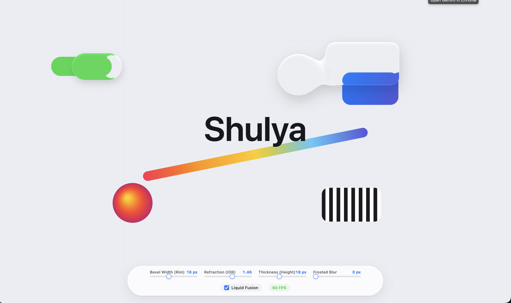

# `@shulya/liquid-glass`

[](https://www.npmjs.com/package/@shulya/liquid-glass)
[](https://liquid.shulya.tech)
[](https://github.com/shulya-tech/liquid-glass)
[-30d158?style=flat-square>)](#why-shulyaliquid-glass)
[](#framework-integrations)
[](https://github.com/shulya-tech/liquid-glass/blob/main/LICENSE)

**`@shulya/liquid-glass`** is an ultra-lightweight, zero-WebGL optical glass rendering engine for modern web applications. Turn any HTML container, card, navigation bar, modal, or interactive widget into a realistic refractive **Liquid Glass** block with real-time control over **`rim`**, **`ior`**, **`height`**, **`frosted`**, and **`fusion`** parameters.

- **Live Interactive Demo:** [https://liquid.shulya.tech](https://liquid.shulya.tech)
- **NPM Package:** [https://www.npmjs.com/package/@shulya/liquid-glass](https://www.npmjs.com/package/@shulya/liquid-glass)
- **GitHub Repository:** [https://github.com/shulya-tech/liquid-glass](https://github.com/shulya-tech/liquid-glass)



---

## Why `@shulya/liquid-glass`?

- **Zero WebGL / Zero GPU Shader Overhead:** Does not spawn WebGL contexts or heavy fragment shaders. Runs on 100% standard browser primitives backed by pre-calibrated empirical lookup tables (`Float32Array` LUTs).
- **Mobile-First & Cool-Running:** Designed for 120 FPS responsiveness on smartphones and tablets with **0% CPU/GPU load when idle**—no battery drain or thermal throttling.
- **Toggleable Liquid Coalescence (`fusion`):** Enabled by default (`fusion: true`) for organic surface merging when elements approach one another, and can be disabled (`fusion: false`) on standalone blocks to skip proximity tracking for maximum performance.
- **Universal Framework Support:** First-class bindings included out of the box for **React**, **Vue 3**, **Svelte**, **Angular**, **SolidJS**, and **Vanilla JS**.
- **Pre-Calibrated Optical Matrix:** Uses a 256-point empirical optical calibration table (`tables/optical_calibration_matrix.xlsx`) for instant $O(1)$ linear lookup of edge deflection, specular rim luminance, and chromatic shift.

---

## Installation

```bash
npm install @shulya/liquid-glass
# or
pnpm add @shulya/liquid-glass
# or
yarn add @shulya/liquid-glass
```

---

## Interactive React Playground (`example/`)

> **Try it online right now:** [**https://liquid.shulya.tech**](https://liquid.shulya.tech)  
> **Source code on GitHub:** [**github.com/shulya-tech/liquid-glass/tree/main/example**](https://github.com/shulya-tech/liquid-glass/tree/main/example)


The repository includes a complete **React + Vite** interactive playground in [`example/`](./example/) ([`example/src/App.jsx`](./example/src/App.jsx)) where you can drag three `<LiquidGlass>` components (a `136×74` capsule slider, a `196×116` rounded card, and a `112×112` circular lens) across a high-contrast optical test stage with a green pill track, diagonal rainbow ribbon, sunset sphere, black/white stripe grating, and centered `"Shulya"` typography.

All rendering in `example/` is powered directly by the `@shulya/liquid-glass/react` adapter (`<LiquidGlass>`, `scheduleStageRedraw`, `OPTICAL_DEFAULTS`) and the precomputed empirical lookup tables `_T0`–`_T4`.

### Running the React Playground Locally

```bash
# 1. Build the library bundles from the root directory
npm run build

# 2. Install example dependencies and start the Vite dev server
cd example
npm install
npm run dev
```

Or run `npm run example` directly from the repository root, then open **`http://localhost:5173`** in your browser to test:

- Dragging any of the 3 `<LiquidGlass>` React components over the typography, stripes, and color gradients.
- Bringing two or all three shapes close together to observe real-time liquid bridge coalescence (`fusion`).
- Adjusting **`Bevel Width (Rim)`** (`6–32 px`), **`Refraction (IOR)`** (`1.10–1.70`), **`Thickness (Height)`** (`6–34 px`), **`Frosted Blur`** (`0–30 px`), and toggling **`Liquid Fusion`** on/off in real time via the bottom control shelf.

---

## Optical Parameters & Strict Bounds

Every component, hook, directive, and controller accepts the following properties. Out-of-range numeric inputs are automatically clamped to their physical `[min, max]` boundaries via `normalizeOptions()`:

| Parameter          |       Type       |  Default   |  Min   |  Max   | Description                                                                                                                                                    |
| :----------------- | :--------------: | :--------: | :----: | :----: | :------------------------------------------------------------------------------------------------------------------------------------------------------------- |
| **`rim`**          |     `number`     |  **`16`**  |  `4`   |  `48`  | Width of the curved perimeter bevel and specular edge highlight (in `px`).                                                                                     |
| **`ior`**          |     `number`     | **`1.46`** | `1.05` | `2.20` | Optical Index of Refraction controlling background bending intensity.                                                                                          |
| **`height`**       |     `number`     |  **`18`**  |  `2`   |  `50`  | Apparent elevation and optical thickness of the glass slab (in `px`).                                                                                          |
| **`frosted`**      |     `number`     |  **`0`**   |  `0`   |  `32`  | Gaussian surface diffusion radius in `px` (`0` = crystal clear, `>0` = frosted satin glass).                                                                   |
| **`fusion`**       |    `boolean`     | **`true`** |   —    |   —    | Enables liquid surface coalescence with neighboring glass blocks. Set to **`false`** for isolated static blocks to bypass proximity checks and maximize speed. |
| **`borderRadius`** | `number \| null` |   `null`   |  `0`   | `999`  | Optional override for corner radius in `px` (automatically inherits CSS `border-radius` when omitted).                                                         |

You can also import the frozen constants `OPTICAL_DEFAULTS` and `OPTICAL_LIMITS` from any entry point to bind UI sliders directly to the valid bounds.

---

## Framework Integrations

### 1. React (`@shulya/liquid-glass/react`)

Use either the `<LiquidGlass>` component or the `useLiquidGlass` hook on any existing element:

```tsx
import { LiquidGlass, useLiquidGlass } from "@shulya/liquid-glass/react";

export function GlassCard() {
  return (
    <LiquidGlass
      rim={16}
      ior={1.46}
      height={18}
      frosted={0}
      fusion={true}
      className="p-6 rounded-3xl"
    >
      <h2>Liquid Glass Card</h2>
      <p>Refractive optical container with zero WebGL overhead.</p>
    </LiquidGlass>
  );
}

// Or via Hook (e.g. with fusion disabled for a static navbar):
export function StaticNavbar() {
  const glassRef = useLiquidGlass<HTMLElement>({
    rim: 16,
    ior: 1.46,
    height: 18,
    frosted: 8,
    fusion: false,
  });

  return (
    <nav ref={glassRef} className="top-nav">
      Navigation
    </nav>
  );
}
```

---

### 2. Vue 3 (`@shulya/liquid-glass/vue`)

Use the `<LiquidGlass>` component or the `v-liquid-glass` directive:

```vue
<script setup>
import { ref } from "vue";
import { LiquidGlass, vLiquidGlass } from "@shulya/liquid-glass/vue";

const ior = ref(1.46);
const frosted = ref(0);
</script>

<template>
  <!-- Interactive coalescing glass block (fusion enabled by default) -->
  <LiquidGlass
    :rim="16"
    :ior="ior"
    :height="18"
    :frosted="frosted"
    :fusion="true"
    class="glass-box"
  >
    <h3>Vue Liquid Glass</h3>
  </LiquidGlass>

  <!-- Standalone static glass block with fusion disabled for extra optimization -->
  <section
    v-liquid-glass="{
      rim: 16,
      ior: 1.46,
      height: 18,
      frosted: 0,
      fusion: false,
    }"
  >
    Optimized isolated glass block
  </section>
</template>
```

---

### 3. Svelte (`@shulya/liquid-glass/svelte`)

Use the `use:liquidGlass` action on any HTML element. Reactive updates are handled automatically:

```svelte
<script>
  import { liquidGlass } from '@shulya/liquid-glass/svelte';

  let rim = 16;
  let ior = 1.46;
  let height = 18;
  let frosted = 0;
  let fusion = true;
</script>

<div
  class="glass-panel"
  use:liquidGlass={{ rim, ior, height, frosted, fusion }}
>
  <h3>Svelte Liquid Glass</h3>
</div>
```

---

### 4. Angular (`@shulya/liquid-glass/angular`)

Attach `attachAngularLiquidGlass` inside your component or wire `LiquidGlassDirective`:

```ts
import {
  Component,
  ElementRef,
  ViewChild,
  AfterViewInit,
  OnDestroy,
} from "@angular/core";
import {
  attachAngularLiquidGlass,
  LiquidGlassController,
} from "@shulya/liquid-glass/angular";

@Component({
  selector: "app-glass-card",
  standalone: true,
  template: `
    <div #glassBox class="glass-card">
      <h3>Angular Liquid Glass</h3>
    </div>
  `,
})
export class GlassCardComponent implements AfterViewInit, OnDestroy {
  @ViewChild("glassBox", { static: true }) glassBox!: ElementRef<HTMLElement>;
  private controller?: LiquidGlassController;

  ngAfterViewInit() {
    this.controller = attachAngularLiquidGlass(this.glassBox, {
      rim: 16,
      ior: 1.46,
      height: 18,
      frosted: 0,
      fusion: true,
    });
  }

  disableFusionForStaticMode() {
    this.controller?.update({ fusion: false });
  }

  ngOnDestroy() {
    this.controller?.destroy();
  }
}
```

---

### 5. SolidJS (`@shulya/liquid-glass/solid`)

Use the reactive `use:liquidGlass` directive with signals:

```tsx
import { createSignal } from "solid-js";
import { liquidGlass } from "@shulya/liquid-glass/solid";

export function SolidGlassDemo() {
  const [rim, setRim] = createSignal(16);
  const [ior, setIor] = createSignal(1.46);
  const [height, setHeight] = createSignal(18);
  const [frosted, setFrosted] = createSignal(0);
  const [fusion, setFusion] = createSignal(true);

  return (
    <div
      class="glass-card"
      use:liquidGlass={() => ({
        rim: rim(),
        ior: ior(),
        height: height(),
        frosted: frosted(),
        fusion: fusion(),
      })}
    >
      <h3>SolidJS Liquid Glass</h3>
    </div>
  );
}
```

---

### 6. Vanilla JS / TypeScript (`@shulya/liquid-glass`)

```js
import {
  createLiquidGlass,
  OPTICAL_DEFAULTS,
  OPTICAL_LIMITS,
} from "@shulya/liquid-glass";

const glass = createLiquidGlass("#my-card", {
  rim: 16, // Clamped between [4, 48]
  ior: 1.46, // Clamped between [1.05, 2.20]
  height: 18, // Clamped between [2, 50]
  frosted: 0, // Clamped between [0, 32]
  fusion: true, // Default: true (set false to isolate element)
});

// Dynamically update parameters at any time:
glass.update({
  rim: 24,
  ior: 1.62,
  height: 28,
  frosted: 8,
  fusion: false,
});
```

---

## Pre-Computed Calibration Dataset

To guarantee zero runtime trigonometric or shader overhead across mobile devices, `@shulya/liquid-glass` ships with pre-sampled empirical lookup arrays located in:

- `tables/optical_calibration_matrix.xlsx` (Excel workbook for inspection and studio tuning)
- `tables/optical_calibration_matrix.csv` (CSV mirror)
- `dist/tables.mjs` (`Float32Array` runtime buffers `_T0` – `_T4`)

---

## Links

- **Live Demo:** [https://liquid.shulya.tech](https://liquid.shulya.tech)
- **NPM Package:** [https://www.npmjs.com/package/@shulya/liquid-glass](https://www.npmjs.com/package/@shulya/liquid-glass)
- **GitHub Repository:** [https://github.com/shulya-tech/liquid-glass](https://github.com/shulya-tech/liquid-glass)
- **Issue Tracker:** [https://github.com/shulya-tech/liquid-glass/issues](https://github.com/shulya-tech/liquid-glass/issues)

---

## License

MIT © [Shulya LLC](https://github.com/shulya-tech)
