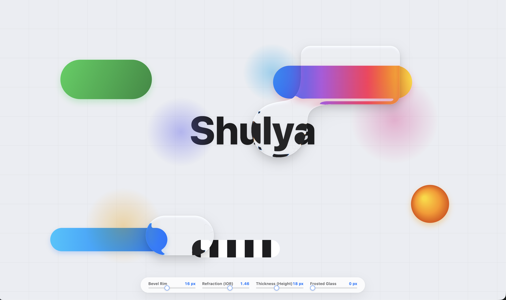

# `@shulya/liquid-glass` — React Interactive Playground (`example/`)

- **Live Demo:** [https://liquid.shulya.tech](https://liquid.shulya.tech)
- **NPM Package:** [https://www.npmjs.com/package/@shulya/liquid-glass](https://www.npmjs.com/package/@shulya/liquid-glass)
- **GitHub Repository:** [https://github.com/shulya-tech/liquid-glass](https://github.com/shulya-tech/liquid-glass)

<p align="center">
  
  <br />
  <sub><b>Interactive React Playground:</b> Live optical refraction, chromatic dispersion, and control shelf.</sub>
</p>

This directory contains a complete **React + Vite** application demonstrating the `<LiquidGlass>` component from `@shulya/liquid-glass/react`.

## Overview

- **Three Draggable `<LiquidGlass>` Components:**
  - **Capsule Slider (`136 × 74 px`, radius `37 px`)** positioned over a green switch track.
  - **Rounded Rectangle (`196 × 116 px`, radius `22 px`)** positioned over an electric blue gradient card.
  - **Circular Lens (`112 × 112 px`, radius `56 px`)** positioned over a warm sunset sphere.
- **High-Contrast Optical Stage:** Features a fine `56 px` architectural hairline grid, a thin diagonal rainbow ribbon, high-contrast black/white stripes, and centered `"Shulya"` typography to inspect edge refraction, chromatic dispersion, and specular bevel highlights.
- **Liquid Surface Coalescence:** Drag any two or all three `<LiquidGlass>` elements close together to observe real-time liquid bridge coalescence powered by the precomputed empirical lookup tables (`_T0`–`_T4`). Elements on the same `z-index` merge naturally into a single organic drop when within `fusionDistance` (default `88 px`).
- **Live React State Controls:**
  - **Bevel Width (`rim`):** `6–32 px` (default `16 px`)
  - **Refraction (`ior`):** `1.10–1.70` (default `1.46`)
  - **Thickness (`height`):** `6–34 px` (default `18 px`)
  - **Frosted Blur (`frosted`):** `0–30 px` (default `0 px`)

## Getting Started

```bash
# 1. From the root of the repository, build the library dist bundles:
npm run build

# 2. Install example dependencies and start the Vite dev server:
cd example
npm install
npm run dev
```

Then open **`http://localhost:5173`** in your browser.
